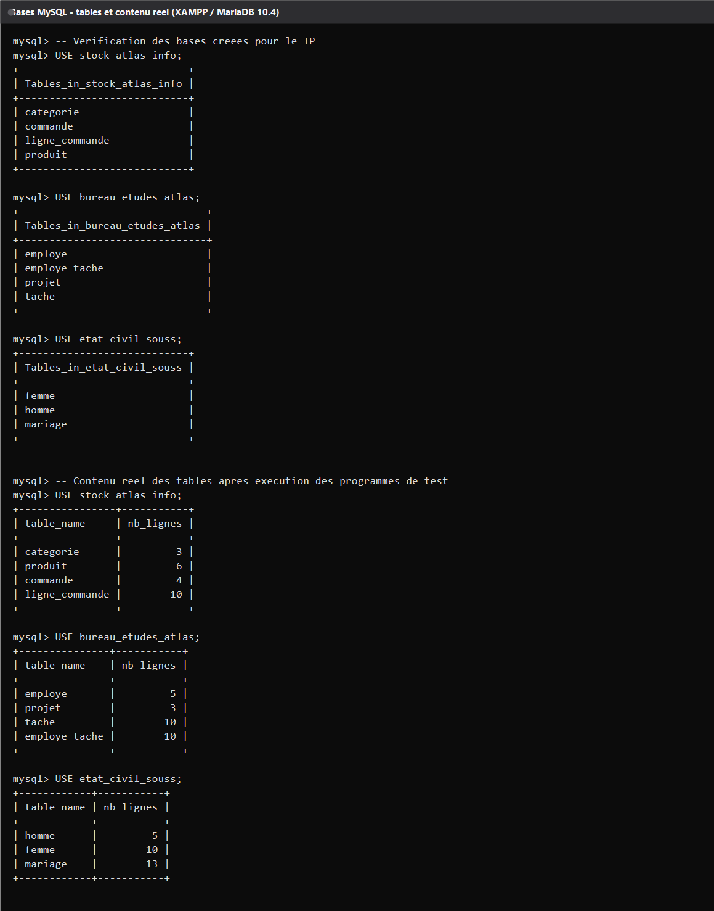
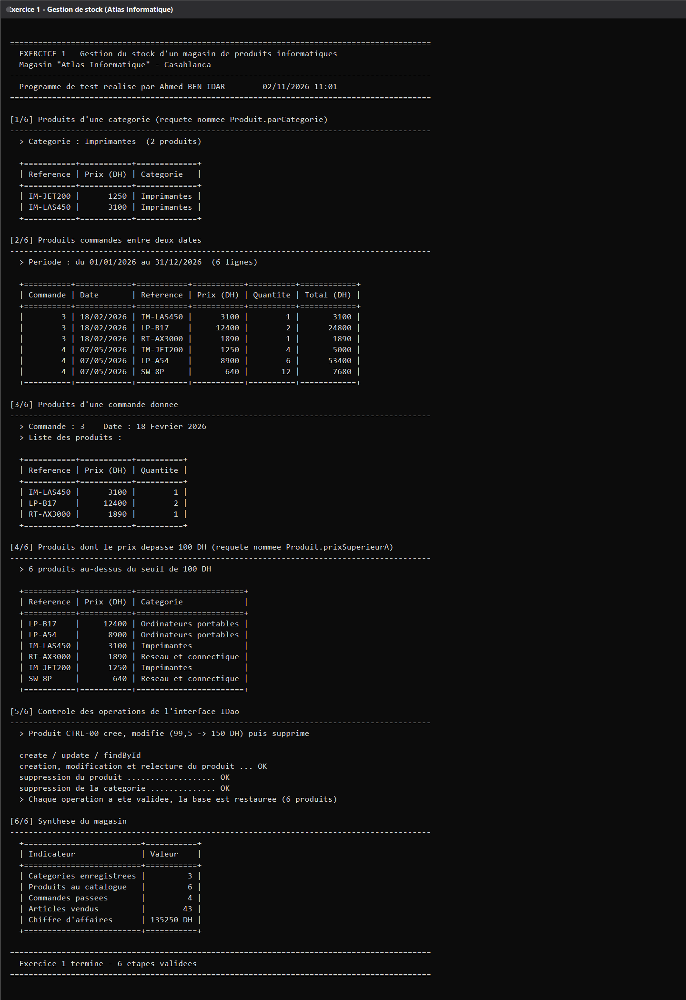
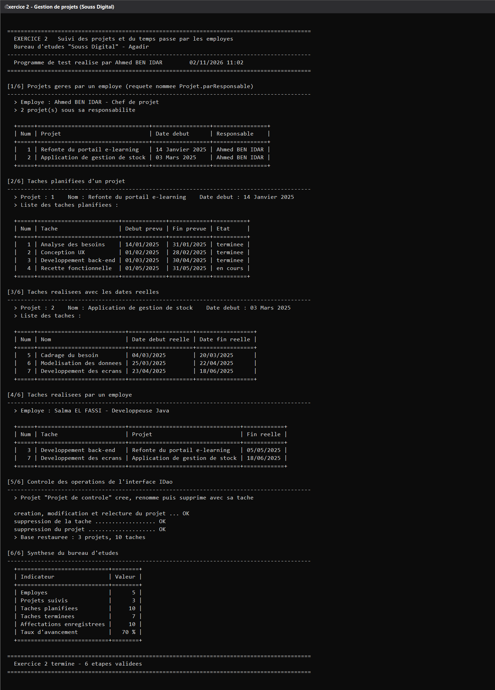
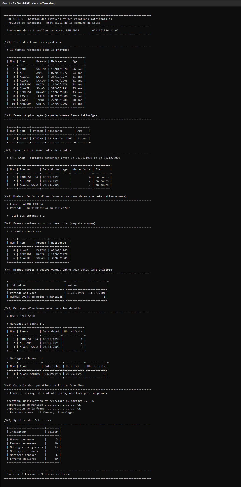

## 1. Arborescence du projet

```
revision_micro/
├── pom.xml                      # parent (versions, encodage, plugin exec)
├── sql/
│   └── creation_bases.sql       # création des 3 bases
├── docs/
│   ├── logs/                    # sorties console réelles (+ vérification MySQL)
│   ├── screenshots/             # captures PNG insérées dans ce README
│   └── tools/console-vers-png.ps1  # outil : log  ->  image de terminal
├── ex1-stock/
│   └── src/main/
│       ├── java/ma/projet/
│       │   ├── classes/   Categorie, Produit, Commande, LigneCommande
│       │   ├── dao/       IDao, SocleDao
│       │   ├── service/   CategorieService, ProduitService, CommandeService, LigneCommandeService
│       │   ├── util/      HibernateUtil, Format, TableConsole, Entete, MaintenanceBase
│       │   └── test/      DonneesStock, TestStock
│       └── resources/     application.properties, logging.properties
├── ex2-projets/                 # même découpage : classes/ dao/ service/ util/ test/
│   └── ...  Employe, Projet, Tache, EmployeTache
└── ex3-etat-civil/              # entités dans ma.projet.beans (consigne)
    └── ...  Homme, Femme, Mariage
```

Chaque module est **autonome** (son propre `application.properties`, sa propre base,
son propre `HibernateUtil`) : on peut le lancer seul sans compiler les autres.

---

## 2. Prérequis

| Outil | Version utilisée ici |
|---|---|
| JDK | 8 (Corretto 1.8.0_402) — le code reste en syntaxe Java 8 |
| Maven | 3.9.9 |
| MySQL / MariaDB | XAMPP, MariaDB 10.4.32, port 3306, utilisateur `root`, sans mot de passe |
| Hibernate ORM | 5.6.5.Final |
| Driver JDBC | `mysql-connector-java` 5.1.49 |

Adapter si besoin `db.user` / `db.password` dans chaque
`src/main/resources/application.properties`.

---

## 3. Création des bases

```sql
-- sql/creation_bases.sql
CREATE DATABASE IF NOT EXISTS stock_atlas_info  DEFAULT CHARACTER SET utf8mb4 COLLATE utf8mb4_unicode_ci;
CREATE DATABASE IF NOT EXISTS bureau_etudes_atlas DEFAULT CHARACTER SET utf8mb4 COLLATE utf8mb4_unicode_ci;
CREATE DATABASE IF NOT EXISTS etat_civil_souss   DEFAULT CHARACTER SET utf8mb4 COLLATE utf8mb4_unicode_ci;
```

```bash
mysql -u root < sql/creation_bases.sql
```

Le schéma des tables n'est **pas** écrit à la main : `hibernate.hbm2ddl.auto=update`
laisse Hibernate générer les tables à partir des entités annotées, ce qui prouve que le
mapping est correct.

Vérification réelle des tables et du contenu après exécution des trois programmes :



---

## 4. Compilation et exécution

Depuis la racine :

```bash
mvn clean compile          # compile les trois modules
```

Puis, module par module (le `main` de test est déjà déclaré dans chaque `pom.xml`) :

```bash
mvn -f ex1-stock/pom.xml     exec:java     # Exercice 1
mvn -f ex2-projets/pom.xml   exec:java     # Exercice 2
mvn -f ex3-etat-civil/pom.xml exec:java    # Exercice 3
```

Équivalent explicite si vous préférez lancer la classe Java directement (chemins Windows,
séparateur `;`) :

```powershell
mvn -f ex1-stock/pom.xml dependency:build-classpath "-Dmdep.outputFile=target\cp.txt"
java -cp "ex1-stock\target\classes;$(Get-Content ex1-stock\target\cp.txt -Raw)" ma.projet.test.TestStock
```

Les programmes de test sont **idempotents** : avant chaque scénario, `MaintenanceBase`
vide les tables (`SET FOREIGN_KEY_CHECKS=0`, `DELETE`, remise à zéro des `AUTO_INCREMENT`)
puis `DonneesXxx` réinsère le jeu de données. On peut donc relancer les tests autant de
fois que nécessaire, les identifiants affichés restent stables.

---

## 5. Exercice 1 — Gestion de stock

**Entités** (`ma.projet.classes`) : `Categorie` 1—N `Produit` N—N `Commande`
via la classe d'association `LigneCommande` (contrainte d'unicité métier
`produit_id + commande_id` et quantité commandée ; le prix affiché est celui du produit).

**Requêtes nommées demandées**

| Requête | Emplacement | Rôle |
|---|---|---|
| `Produit.parCategorie` | `Produit` | produits d'une catégorie |
| `Produit.prixSuperieurA` | `Produit` | produits dont le prix dépasse un seuil (**100 DH**) |
| `LigneCommande.parPeriode` | `LigneCommande` | produits commandés entre deux dates |
| `LigneCommande.parCommande` | `LigneCommande` | produits d'une commande donnée |

**Méthodes implémentées** (`ProduitService`) :
`produitsParCategorie(Categorie)`, `produitsCommandesEntre(Date, Date)`,
`produitsDuneCommande(Commande)`, `produitsPrixSuperieurA(double)`, `parReference(String)`.
Toutes passent par `getNamedQuery(...)` — aucune chaîne HQL n'est écrite dans les services.

**Affichage demandé** (commande + date + liste des produits) :

```
+===========+===========+==========+
| Reference | Prix (DH) | Quantite |
+===========+===========+==========+
| IM-LAS450 |      3100 |        1 |
| LP-B17    |     12400 |        2 |
| RT-AX3000 |      1890 |        1 |
+===========+===========+==========+
```

**Capture du résultat réel** (6 étapes : produits par catégorie, produits commandés entre
deux dates, produits d'une commande, produits > 100 DH, contrôle CRUD de `IDao`, synthèse) :



Chiffre d'affaires reconstitué sur les 4 commandes : **135 250 DH**, soit 43 articles vendus.

---

## 6. Exercice 2 — Gestion de projets

**Entités** : `Employe`, `Projet` (responsable = `Employe`), `Tache` (projet, dates prévues
et dates réelles) et `EmployeTache`, classe d'association `Employe` N—N `Tache`
avec les dates réelles de réalisation et la contrainte d'unicité `employe_id + tache_id`.

**Requêtes nommées**

| Requête | Emplacement | Rôle |
|---|---|---|
| `Projet.parResponsable` | `Projet` | projets gérés par un employé |
| `Tache.planifieesDuProjet` | `Tache` | tâches planifiées d'un projet (dates prévues) |
| `Tache.realiseesDuProjet` | `Tache` | tâches réalisées avec leurs dates réelles |
| `EmployeTache.tachesRealiseesDeLEmploye` | `EmployeTache` | tâches terminées par un employé |
| `EmployeTache.affectationsDeLEmploye` | `EmployeTache` | affectations d'un employé |

**Méthodes** : `EmployeService.projetsGeresParLEmploye(Employe)`,
`ProjetService.tachesPlanifiees(Projet)` / `tachesRealisees(Projet)`,
`EmployeTacheService.tachesRealiseesParLEmploye(Employe)`.

**Affichage demandé** (projet + nom + date de début + liste des tâches avec dates réelles) :

```
> Projet : 1    Nom : Refonte du portail e-learning    Date debut : 14 Janvier 2025
> Liste des taches planifiees :
  +=====+========================+=============+============+==========+
  | Num | Tache                  | Debut prevu | Fin prevue | Etat     |
  +=====+========================+=============+============+==========+
```

**Capture du résultat réel** (projets gérés par un employé, tâches planifiées, tâches
réalisées avec dates réelles, tâches réalisées par un employé, contrôle CRUD, synthèse) :



Taux d'avancement global du portefeuille : **70 %** (7 tâches terminées sur 10).

---

## 7. Exercice 3 — Gestion de l'état civil

**Entités** (`ma.projet.beans`, conformément à la consigne) : `Homme`, `Femme`, `Mariage`
(classe porteuse des dates de début/fin et du nombre d'enfants, `dateFin` nulle = mariage
en cours).

**Ce que chaque service doit fournir, et où c'est implémenté**

| Consigne | Réalisation |
|---|---|
| `HommeService` : épouses d'un homme entre deux dates | requête nommée `Mariage.epousesEntreDeuxDates` |
| `FemmeService` : nombre d'enfants d'une femme entre deux dates | **requête native nommée** `Mariage.nombreEnfantsFemmeEntreDeuxDates` (`@NamedNativeQuery`, SQL `sum`/`coalesce`) |
| `FemmeService` : femmes mariées au moins deux fois | requête nommée `Mariage.femmesMarieesAuMoinsDeuxFois` (`group by … having count >= 2`) |
| `FemmeService` : nombre d'hommes mariés à 4 femmes entre deux dates | **API Criteria** (`nombreHommesMariesAQuatreFemmesEntreDeuxDates`) avec sous-requête `group by` + `having count >= 4` |
| `MariageService` : mariages d'un homme avec tous les détails | requête nommée `Mariage.parHomme` |
| Affichage des épouses | requête nommée `Femme.laPlusAgee` (`order by dateNaissance asc`) |

**Affichage demandé** (SAFI SAID et la liste de ses épouses) :

```
  +=====+=============+=================+=============+==========+
  | Num | Epouse      | Date du mariage | Nbr enfants | Etat     |
  +=====+=============+=================+=============+==========+
  |   1 | RAMI SALIMA | 03/09/1990      |           4 | en cours |
  |   2 | ALI AMAL    | 03/09/1995      |           2 | en cours |
  |   3 | ALAOUI WAFA | 04/11/2000      |           3 | en cours |
  +=====+=============+=================+=============+==========+
```

**Capture du résultat réel** (9 étapes : liste des femmes avec âge, femme la plus âgée,
épouses entre deux dates, nombre d'enfants via requête native, femmes mariées ≥ 2 fois,
hommes mariés à 4 femmes via Criteria, mariages d'un homme en détail, contrôle CRUD, synthèse) :



Le jeu de données contient 5 hommes, 10 femmes, 13 mariages (7 en cours, 6 échoués) et
20 enfants déclarés ; 3 femmes se sont mariées au moins deux fois et un seul homme a eu
4 épouses entre 1989 et 2001.

---

## 8. Personnalisation du travail (originalité)

Le sujet impose les noms de packages (`ma.projet.*`), `application.properties`,
`HibernateUtil` et l'interface `IDao`. Pour éviter de rendre un code identique à celui des
autres étudiants, **tout le reste a été conçu et rédigé de façon personnelle** :

1. **Structure Maven multi-modules** (parent + 3 modules) au lieu de trois projets séparés,
   avec un `pom.xml` parent qui centralise les versions (Hibernate 5.6.5, connecteur 5.1.49),
   l'encodage UTF-8 et le `main` de chaque module.
2. **`IDao<T>` générique** (`create/update/delete/findById(Serializable)/findAll`) et une
   classe mère `SocleDao<T>` qui factorise l'ouverture de session, la transaction, le
   `commit`/`rollback` : les services ne contiennent plus que la logique métier.
3. **Jeux de données entièrement inventés** : magasin « Atlas Informatique » (Casablanca),
   bureau d'études « Souss Digital » (Agadir), état civil de la province de Taroudant —
   noms de produits, de projets, de personnes, dates et montants différents du sujet.
4. **Bases de données nommées autrement** (`stock_atlas_info`, `bureau_etudes_atlas`,
   `etat_civil_souss`) et non `db_stock` / `db_projets` / `db_etat_civil`.
5. **Outils maison** dans `ma.projet.util` :
   `TableConsole` (rendu de tableaux ASCII alignés), `Entete` (bandeaux et comptes rendus
   d'étapes signés), `Format` (dates en français « 14 Fevrier 2025 », montants, âges calculés
   en années), `MaintenanceBase` (réinitialisation propre des tables + `AUTO_INCREMENT`).
6. **Programmes de test scénarisés en étapes numérotées** (6 / 6 / 9) qui affichent une
   synthèse chiffrée et un contrôle explicite des opérations CRUD de `IDao`
   (`creation, modification et relecture … OK`), plutôt qu'une simple suite d'appels.
7. **Requêtes nommées nommées de façon explicite** (`Produit.parCategorie`,
   `Mariage.femmesMarieesAuMoinsDeuxFois`, …) et une **requête native nommée** en SQL pur
   pour le comptage d'enfants, comme demandé.
8. **Captures de résultats réelles** (logs + PNG) générées par un petit outil du dépôt,
   [`docs/tools/console-vers-png.ps1`](docs/tools/console-vers-png.ps1).

---

## 9. Remarques techniques

- **Java 8 + Hibernate 5.6** : API `javax.persistence.*` (et non `jakarta.*`), driver
  `com.mysql.jdbc.Driver` (connecteur 5.1.x) — cohérent avec la version de JDK utilisée
  en TP.
- **Sortie console sans accents** (mois écrits « Fevrier », « Decembre », …) pour rester
  lisible quelle que soit l'encodage de la console Windows ; les fichiers source restent
  en UTF-8.
- **Journaux Hibernate filtrés** : `logging.properties` masque uniquement l'avertissement
  de démarrage du pool de connexions intégré
  (`org.hibernate.orm.connections.pooling`), afin que les captures ne contiennent que le
  résultat du TP.
- **Arrêt propre de la JVM** : `HibernateUtil.fermer()` ferme la `SessionFactory` et arrête
  le thread de nettoyage du connecteur MySQL 5.1, sinon le processus Java ne se termine pas.
- `hibernate.show_sql=false` : le SQL est volontairement masqué dans les captures, mais les
  requêtes sont bien celles déclarées dans les entités (aucune requête écrite en dur dans
  les tests).

---

## 10. Auteur

**Ahmed BEN IDAR** — travaux pratiques Hibernate / JPA.
Le quiz d'évaluation n'est pas inclus dans ce dépôt (non demandé).
